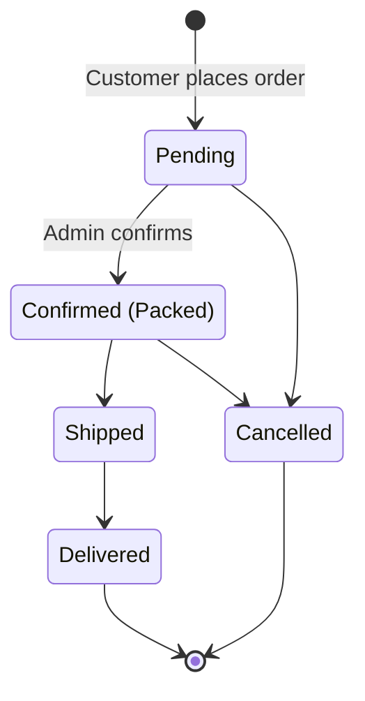
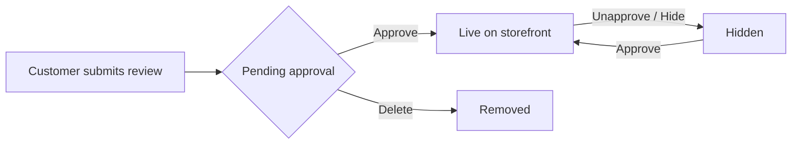
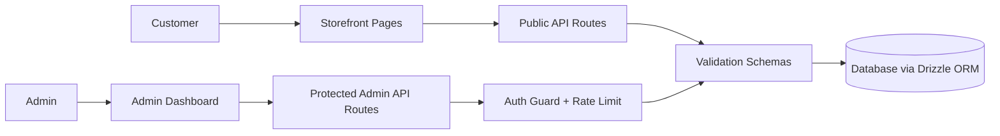

<div align="center">


# Veloura Naturals

### Organic hair care e-commerce with a full admin dashboard.

A fast, mobile-first storefront for a single-product organic hair oil brand, with order tracking, customer reviews, and a secure back office for managing products, orders, payments, and reviews.

<br />

[](https://veloura-naturals.vercel.app)


[**Live Demo**](https://veloura-naturals.vercel.app) · [**Features**](#-features) · [**Architecture**](#-architecture) · [**Getting Started**](#-getting-started) · [**Screenshots**](#-screenshots)

</div>

---

## 📖 Overview

**Veloura Naturals** is a full-stack e-commerce platform built for an organic hair growth oil brand. Customers can browse the product, read verified reviews, and place an order in a single form. The store owner manages everything from a protected admin dashboard, with no code changes needed.

The checkout is built for the Pakistani market: customers pay by **Cash on Delivery**, **Meezan Bank**, or **EasyPaisa**, and every order is tracked through a clear fulfillment lifecycle.

**Highlights**

- ⚡ Next.js App Router with server-rendered pages and a polished, brand-consistent UI
- 🧾 One-page ordering: customer details, quantity, payment method, and live totals in a single form
- 🛠️ Admin dashboard for products, orders and payments, review moderation, store settings, and account security
- ⭐ Review system with photo uploads, a lightbox viewer, and admin approval before anything goes live
- 🔒 Protected admin: hashed credentials, session-based auth, rate limiting, and guarded API routes
- 📡 Resilient UX: offline banner, route-level error boundaries, and a mobile navigation bar

---

## ✨ Features

### 🛍️ Storefront

| | Feature | Description |
|:-:|:--|:--|
| 🏠 | **Landing Page** | Hero section with animated headline, benefit cards, and live rating summary |
| 🛒 | **Shop & Product Page** | Image gallery, bestseller badge, sale and compare-at pricing, and live stock status |
| 🧾 | **Order Form** | Name, phone, city, address, quantity, payment method, and notes, with an itemized total |
| 💳 | **Flexible Payments** | Cash on Delivery, Meezan Bank, and EasyPaisa |
| 📦 | **Order Tracking** | Customers check the status of an order from the Track Order page |
| ⭐ | **Reviews** | Star ratings, written reviews, photo uploads, and a lightbox gallery |
| ✉️ | **Contact Form** | Messages delivered to the store owner through a validated API route |
| 📱 | **Responsive** | Mobile navigation and layouts tuned for phones, where most customers shop |
| 📡 | **Offline Awareness** | Banner that warns users when they lose connectivity |

### 🔐 Admin Dashboard

| | Feature | Description |
|:-:|:--|:--|
| 📊 | **Overview** | At-a-glance summary of store activity |
| 🏷️ | **Products** | Create, edit, and remove products through a modal form |
| 🧾 | **Orders & Payments** | Filter by status, change status inline, and view each order's payment method and total |
| ⭐ | **Review Moderation** | Approve, unapprove or hide, and delete reviews; approved reviews go live instantly |
| ⚙️ | **Settings** | Store-wide configuration managed from the dashboard |
| 🔑 | **My Account** | Update credentials, with login, forgot-password, and reset-password flows |

### 🔄 Order Lifecycle



### 💬 Review Moderation Flow



---

## 🏗️ Architecture



**Request flow:** every mutation is validated against shared schemas. Admin routes additionally pass an authentication guard and rate limiting before any database access.

### 🛡️ Security

| Concern | Approach |
|:--|:--|
| **Passwords** | Stored as hashes, never in plain text |
| **Sessions** | Session-based admin authentication |
| **Authorization** | Every admin API route is protected by a shared admin guard, with a dedicated forbidden page |
| **Abuse protection** | Rate limiting on authentication endpoints |
| **Input validation** | Shared validation schemas used by the API routes |
| **Error handling** | Route-level and global error boundaries so failures degrade gracefully |
| **Password recovery** | Forgot and reset password flows for admin accounts |

---

## 🛠️ Tech Stack

| Layer | Technology |
|:--|:--|
| **Framework** | [Next.js](https://nextjs.org/) (App Router) |
| **UI** | [React](https://react.dev/) · [Tailwind CSS](https://tailwindcss.com/) |
| **Language** | [TypeScript](https://www.typescriptlang.org/) |
| **Database & ORM** | [Drizzle ORM](https://orm.drizzle.team/) with SQL migrations |
| **Auth** | Session-based admin authentication with hashed passwords |
| **Hosting** | [Vercel](https://vercel.com/) |

---

## 📁 Project Structure

<details>
<summary><b>Expand the file tree</b></summary>

```text
veloura-naturals
├── .brain/                       # Architecture and data-flow notes
├── .agents/rules/                # Commit style conventions
└── veloura/
    ├── drizzle/                  # SQL migrations and snapshots
    ├── public/images/            # Brand assets, product and review images
    └── src/
        ├── app/
        │   ├── page.tsx          # Landing page
        │   ├── shop/             # Shop listing
        │   ├── product/          # Product page and order form
        │   ├── track-order/      # Order tracking
        │   ├── contact/          # Contact page
        │   ├── admin/
        │   │   ├── (protected)/  # overview · products · orders · reviews
        │   │   │                 # settings · account
        │   │   └── login · forgot-password · reset-password · forbidden
        │   └── api/              # Public + protected admin endpoints
        ├── components/
        │   ├── admin/            # Shell, sidebar, product form modal
        │   └── ...               # Order form, reviews, gallery, header, footer
        └── lib/
            ├── auth/             # Sessions, password hashing, rate limit, guard
            ├── db/               # Schema, connection, migrate, seed
            ├── validation/       # Shared validation schemas
            └── data.ts · utils.ts · admin-fetch.ts
```

</details>

---

## 🚀 Getting Started

### Prerequisites

- Node.js 20+
- A database supported by the project's Drizzle configuration

### Installation

```bash
# 1. Clone the repository
git clone https://github.com/your-username/veloura-naturals.git
cd veloura-naturals/veloura

# 2. Install dependencies
npm install

# 3. Configure environment variables
cp .env.example .env

# 4. Apply migrations and seed initial data
npm run db:migrate
npm run db:seed

# 5. Start the development server
npm run dev
```

Open [http://localhost:3000](http://localhost:3000) in your browser.

### Environment Variables

All required variables are documented in [`.env.example`](./.env.example). Copy it to `.env` and fill in your own values.

> [!WARNING]
> Never commit your `.env` file. Use long, random secrets for session signing and rotate them if they are ever exposed.

---

## 📜 Available Scripts

| Command | Description |
|:--|:--|
| `npm run dev` | Start the local development server |
| `npm run build` | Create an optimized production build |
| `npm run start` | Run the production server |
| `npm run lint` | Lint the codebase |
| `npm run db:migrate` | Apply database migrations |
| `npm run db:seed` | Seed the database with initial data |

---

## 🌐 Deployment

Veloura Naturals is deployed on **Vercel**.

1. Import the repository into Vercel and set the project root to `veloura`.
2. Add the environment variables from `.env.example`.
3. Run the database migrations against the production database.
4. Deploy. Vercel builds every push and creates preview deployments for branches.

---

## 📸 Screenshots

| Storefront | Product & Checkout |
|:-:|:-:|
|  | 
 |

| Orders & Payments | Review Moderation |
|:-:|:-:|
|  |  |

---

## 📄 License

This project is privately owned by **Veloura Naturals**. All rights reserved © 2026.

---

<div align="center">

Designed & developed by **Saad Ullah Irfan** for **Veloura Naturals**

[**🔗 Visit the Live Store**](https://veloura-naturals.vercel.app)

</div>
